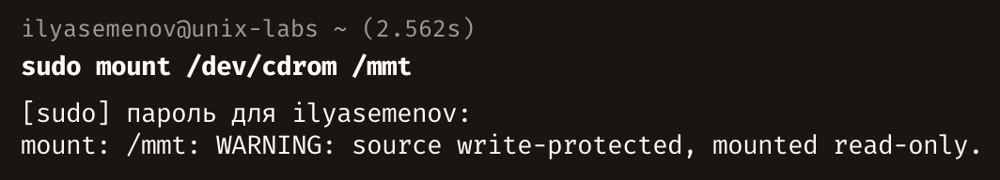
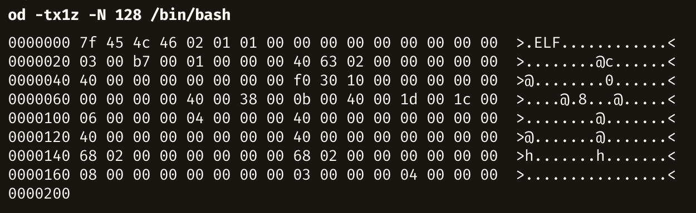
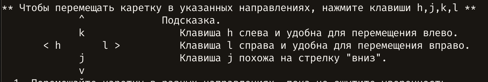
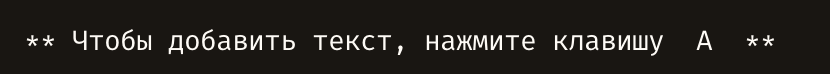
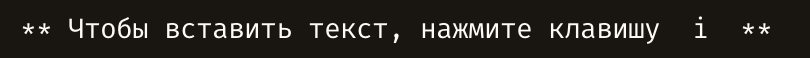
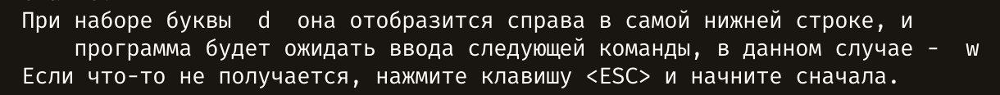
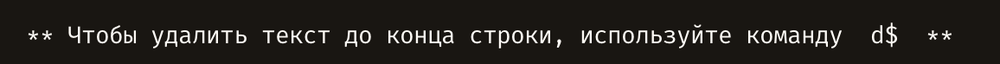
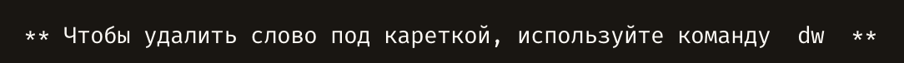

# Лабораторные работы по UNIX

> Условия сохранены по исходному заданию `tex/graphics/labs.pdf`. Результаты выполнения встроены непосредственно в соответствующие упражнения. LaTeX-версия отчёта сохранена отдельно.

# Лабораторная работа 1. Интерактивная работа в системе. Пользовательская учетная запись

## Упражнение 1.1. Загрузка операционной системы. Вход в систему

1. Включите компьютер.

2. В приглашении загрузчика выбора операционной системы выберите Linux.

3. Проследите за сообщениями системы, выдаваемыми в процессе загрузки. Появление приглашения к вводу имени пользователя, означает окончание процесса загрузки системы. Примечание 1: для отображения полного лога загрузки ОС требуется убрать параметр ядра quite. Примечание 2: если по умолчанию установлен графический вход в ОС, переключитесь на виртуальную консоль сочетанием клавиш “Ctrl-Alt-F1” или “Ctrl- Alt-F2”.

4. Зафиксируйте приглашение к вводу имени пользователя и расшифруйте его составляющие:

5. В приглашении к вводу имени пользователя введите имя учетной записи student или другую доступную учетную запись.

6. Зафиксируйте приглашение к вводу пароля и расшифруйте его составляющие:

7. В приглашении к вводу пароля введите password или другой установленный пароль. В случае правильного ввода имени пользователя и пароля появится приглашение к вводу команд.

8. Зафиксируйте появившиеся сообщения и приглашение к вводу команд и расшифруйте его составляющие:

## Упражнение 1.2. Виртуальные терминалы

1. Используя клавиши Alt+Fx, Alt+←, Alt+→ переключитесь и войдите в систему на 2-ом, 4-ом и 6-ом терминале. Примечание: если работаете в графической системе для перехода используйте сочетание “Ctrl-Alt+Fx”.

2. Зафиксируйте появляющееся сообщение от системы:

3. Проследите за появившимися приглашениями к вводу команд.

4. При помощи команды tty, получите и зафиксируйте информацию о 2-ом, 4-ом и 6-ом виртуальном терминале соответственно:

5. Вернитесь на терминал #1.

6. При помощи команды clear очистите терминал, проследите за реакцией системы.

Примечание: если данное упражнение невыполнимо с использованием виртуальных терминалов, например, при использовании MacOS X или WSL, то выполните tty для эмулятора терминала.

## Упражнение 1.3. Завершение сеанса

1. Последовательно переключаясь между виртуальными терминалами, завершите сеанс работы с системой на терминалах, на которых вы входили в систему, при помощи команд exit, logout, либо используя комбинацию клавиш ^D.

2. Проследите за соответствующей реакцией системы.

## Упражнение 1.4. Команды для получения информации о системе и работающих пользователях

При помощи следующих команд: whoami, id, users, who, w, date, cal, uname, uptime получите информацию о системе и пользователях и зафиксируйте ее:

   - **a.** имя текущего пользователя:

   - **b.** его идентификаторы UID, GID и идентификаторы вторичных групп:

   - **c.** количество и имена пользователей, работающих в системе, их терминалы, время работы в системе и время входа в систему, выполняемые команды:

   - **d.** системная дата и время:

   - **e.** календарь текущего месяца:

   - **f.** версия операционной системы компьютера:

   - **g.** время работы операционной системы от момента запуска и нагрузку на операционную систему:

## Упражнение 1.5. Редактирование командной строки командного интерпретатора bash и история команд

1. Используя клавиши ↑, ↓ просмотрите историю вводимых ранее команд.

2. Используя клавиши ←, →, Del, BackSpace, ^H, ^?, ^U потренируйтесь редактировать вводимую команду.

3. Начните набирать любую известную вам команду (первые несколько букв), воспользуйтесь клавишей Tab для автоматического завершения ввода команды.

4. При помощи команды: history получите историю ранее вводимых комманд и зафиксируйте три последние:

5. Повторите любую ранее вводимую команду при помощи ссылки на ее номер: !n, где n - номер введенной ранее команды.

## Упражнение 1.6. Свойства пользовательской учетной записи

1. При помощи команды: passwd измените пароль учетной записи. Зафиксируйте появляющиеся сообщения:

2. При помощи команды: finger посмотрите и зафиксируйте информацию о свойствах учетных записей student и суперпользователя соответственно:

3. При помощи команды: chfn измените содержание информационного свойства (GECOS) учетной записи student. Зафиксируйте появляющиеся сообщения:

4. При помощи команды: chsh измените начальный командный интерпретатор учетной записи student. Зафиксируйте появляющиеся сообщения:

5. Посмотрите и зафиксируйте изменения в свойствах учетной записи student:

6. Завершите сеанс работы пользователя в системе и заново войдите в систему, проследите за изменениями, произошедшими вследствие смены начального командного интерпретатора:

## Упражнение 1.7. Изменение контекста пользователя

1. При помощи команды: su измените контекст текущего пользователя student на контекст пользователя vinnie (или другого пользователя), и зафиксируйте его идентификаторы UID, GID и идентификаторы вторичных групп. Примечание: если второго пользователя в системе не существует, то добавьте его с помощью команд useradd и passwd:

2. При помощи команды: exit вернитесь в контекст текущего пользователя student, убедитесь в этом, проверив его идентификаторы UID, GID и идентификаторы вторичных групп:

## Упражнение 1.8. Общение между пользователями вычислительной системы

1. Переключитесь и войдите в систему на свободном виртуальном терминале, воспользовавашись учетной записью vinnie. Вернитесь на терминал пользователя student.

2. При помощи команды write пошлите различные сообщения (завершая ввод каждого сообщения управляющим символом ^D - символом завершения ввода) пользователю vinnie, проследите за появляющимися на терминале пользователя vinnie сообщениями:

3. При помощи команды mesg отключите возможность приема сообщений пользователем vinnie. Попробуйте послать сообщения пользователю vinnie, проследите за появляющимися сообщениями:

4. При помощи команды wall пошлите сообщение всем пользователям сразу (завершая ввод каждого сообщения управляющим символом ^D - символом завершения ввода), проследите за появляющимися сообщениями:

**Лабораторная работа зачтена:**

**Дата:**

**Подпись преподавателя:**

# Лабораторная работа 2. Работа со справочными системами

## Упражнение 2.1. Страницы электронного руководства UNIX

1. При помощи команды: man man ознакомтесь со справкой по команде man. Зафиксируйте назначение команды man:

2. Страницы руководства выводятся на терминал постранично при помощи программы постраничной разбивки (PAGER). Вызовите встроенную справку по программе постраничной разбивки с помощью клавиши h. Ознакомьтесь с основами работы со справочной системой и зафиксируйте основные комбинации клавиш, используемые для навигации и поиска в справочной системе, а именно:

   - **a.** клавиши построчного и постраничного листания вверх и вниз:

   - **b.** клавишу выхода из справочной системы:

   - **c.** клавиши поиска информации в странице руководства:

   - **d.** клавиши повторения предыдущего поиска:

3. При помощи клавиш поиска и повторения поиска найдите на текущей странице все появления слова page, зафиксируйте использованные сочетания клавиш:

4. При помощи команды: man &lt;номер раздела> intro ознакомьтесь с назначением всех восьми разделов справочной системы. Зафиксируйте их назначение:

5. При помощи команды: whatis получите краткую справку по всем известным вам командам. Зафиксируйте и расшифруйте составляющие нескольких описаний команд:

6. При помощи команды: apropos воспользуйтесь контекстным поиском справочной информации по любому ключевому слову. Зафиксируйте и расшифруйте составляющие нескольких найденных ссылок:

## Упражнение 2.2. Встроенная справка командного интерпретатора bash

1. При помощи команды: help help ознакомьтесь со справкой по команде help. Зафиксируйте назначение команды help:

2. При помощи команды: help выведите список встроенных команд bash.

3. Посмотрите встроенную справку по командам: cd, history, logout, pwd. Зафиксируйте назначение этих команд:

## Упражнение 2.3. Справочная система GNU Info

1. При помощи команды: info info ознакомьтесь со справкой по команде info. Примечание: в системах отличных от GNU данная справочная система может остсутствовать. Зафиксируйте назначение команды info:

2. Вызовите встроенную справку по программе GNU Info с помощью клавиши h. Ознакомьтесь с основами работы со справочной системой и зафиксируйте основные комбинации клавиш, используемые для навигации и поиска в справочной системе, а именно:

   - **a.** клавиши построчного и постраничного листания вверх и вниз:

   - **b.** клавиши навигации по страницам справочной системы:

   - **c.** клавиши навигации по пунктам меню справочной системы:

   - **d.** клавиши навигации по перекрестным ссылкам справочной системы:

   - **e.** клавишу выхода из справочной системы:

   - **f.** клавиши поиска информации на странице справочной системы:

**Лабораторная работа зачтена:**

**Дата:**

**Подпись преподавателя:**

# Лабораторная работа 3. Пользовательское окружение. Пользовательский профиль

## Упражнение 3.1. Переменные окружения. Переменные командного интерпретатора

1. Посмотрите значение переменных окружения с помощью команды env. Зафиксируйте значения переменных окружения PATH, LANG, TERM:

2. Установите в переменную окружения PATH пустое значение.

3. Проследите за реакцией различных команд (date, man, ...). Зафиксируйте произошедшие изменения:

4. Восстановите старое значение переменной окружения PATH.

5. Установите в переменную окружения LANG значение любого языка в формате язык_[СТРАНА.[кодировка]].

6. Проследите за реакцией различных команд (date, man, ...). Зафиксируйте произошедшие изменения:

7. Восстановите старое значение переменной окружения LANG.

8. Установите в переменную окружения TERM значение vt100.

9. Проследите за реакцией различных команд (mcedit, man, ...). Зафиксируйте произошедшие изменения:

10. Восстановите старое значение переменной окружения TERM.

11. Посмотрите значение внутренних переменных командного интерпретатора bash с помощью команды set. Зафиксируйте значение переменной PS1:

12. Установите во внутреннюю переменную PS1 любое значение.

13. Проследите за реакцией командного интерпретатора. Зафиксируйте произошедшие изменения:

## Упражнение 3.2. Конфигурационные файлы пользовательского окружения. Пользовательский профиль

1. Создайте файл .plan в домашнем каталоге пользователя. Запишите в него любую информацию.

2. При помощи команды finger посмотрите и зафиксируйте изменения в свойствах пользователя student:

3. Отредактируйте файл .bashrc или .bash_profile в домашнем каталоге пользователя.

Примечание: если используется интерпретатор отличный от bash, то данные файлы не будут считаны, используйте .profile или специфичный для вашего интерпретатора файл конфигурации. Запишите в файл команду присвоения в переменной окружения LANG значение любого языка в формате язык_[СТРАНА.[кодировка]]:

4. Завершите сеанс пользователя. Войдите в систему с использованием учетной записи student.

5. Проследите за реакцией различных команд (date, man, ...). Зафиксируйте произошедшие изменения:

6. Отредактируйте файл .bash_profile в домашнем каталоге пользователя. Запишите в него команду установки в переменную PS1 собственного cтрокового значения для приглашения командного интерпретатора:

7. Завершите сеанс пользователя. Войдите в систему с использованием учетной записи student.

8. Проследите за реакцией командного интерпретатора. Зафиксируйте произошедшие изменения:

**Лабораторная работа зачтена:**

**Дата:**

**Подпись преподавателя:**

# Лабораторная работа 4. Файлы и файловая система UNIX

## Упражнение 4.1. Изучение структуры файловой системы

При помощи следующих команд: pwd, cd, ls отработайте основные операции навигации в файловой системе:

   - **a.** Перейдите в корневой каталог.

   - **b.** Спускаясь по дереву каталогов, пройдитесь по основным каталогам и подкаталогам, и ознакомьтесь с их содержанием.

   - **c.** Зафиксируйте структуру иерархии файловой системы и назначение основных каталогов:

| Каталог | Назначение |
|---|---|
| `/` | Корень файловой системы. |
| `/etc` | Системные настройки. |
| `/home` | Домашние каталоги пользователей. |
| `/usr` | Программы, библиотеки и общие данные. |
| `/var` | Изменяемые данные и журналы. |
| `/tmp` | Временные файлы. |
| `/dev` | Файлы устройств. |
| `/proc`, `/sys` | Интерфейсы ядра. |
| `/run` | Данные работающих служб. |
| `/boot` | Файлы загрузки. |

## Упражнение 4.2. Типы файлов

1. Для экземпляров различных типов файлов:

   - **a.** обычный файл (/etc/fstab, /bin/bash, /usr/bin/apropos)

   - **b.** каталог (/tmp)

   - **c.** специальный файл устройства (/dev/sda, /dev/tty1)

   - **d.** именованный канал (/run/systemd/initctl/fifo)

   - **e.** сокет (/run/systemd/journal/dev-log)

   - **f.** символическая ссылка (/dev/cdrom)

Обозначение типа объекта первым символом в выводе `ls -l`:

| Символ | Тип объекта |
|---|---|
| `-` | обычный файл |
| `d` | каталог |
| `b` | блочное устройство |
| `c` | символьное устройство |
| `p` | именованный канал (FIFO) |
| `s` | сокет |
| `l` | символическая ссылка |

Поля строки `ls -l` слева направо:

| Поле | Что обозначает |
|---|---|
| `-rw-r--r--` | тип объекта и права владельца, группы и остальных пользователей |
| `1` | количество жёстких ссылок |
| `root` | владелец |
| `root` | группа |
| `1234` | размер в байтах; для устройства — номера `major, minor` |
| дата и время | время последнего изменения содержимого |
| имя | имя объекта; у символической ссылки также выводится `-> цель` |

Примечание: при отсутствии файлов из перечня найдите аналог соответствующего типа.

2. Запишите особенности отображения различных типов файлов командой ls -l:

3. Используя команды: stat, file исследуйте метаданные и содержимое различных типов файлов (из Шаг 1):

## Упражнение 4.3. Манипулирование объектами дерева каталогов UNIX

При помощи следующих команд: touch, mkdir, rmdir, cp, mv, rm, ln, mkfifo, mknod отработайте основные операции работы с файловой системой, зафиксируйте полученные результаты:

   - **a.** перейдите в домашний каталог пользователя:

   - **b.** получите информацию о текущем рабочем каталоге:

   - **c.** получите информацию о содержимом текущего каталога:

   - **d.** создайте новый подкаталог subdir в текущем каталоге:

   - **e.** перейдите в него:

   - **f.** создайте в данном подкаталоге новый файл myfirstfile:

   - **g.** создайте мягкую symblink и жесткую hardlink ссылки на него:

   - **h.** переместите и/или скопируйте файл myfirstfile в вышележащий каталог:

   - **i.** удалите оставшиеся файлы:

   - **j.** перейдите в вышележащий каталог и удалите созданный вами подкаталог subdir и файл myfirstfile:

   - **k.** создайте именованный канал myfifo:

   - **l.** создайте образ оптического диска, находящийся в накопителе /dev/cdrom:

## Упражнение 4.4. Поиск файлов

При помощи следующих команд: find, whereis, which отработайте основные операции поиска файлов, зафиксируйте полученные результаты:

   - **a.** найдите в каталоге /usr все файлы размером больше 800Кb

   - **b.** найдите информацию о всех исполняемых файлах, страницах руководства и исходных текстах программы ls

   - **c.** найдите информацию о местоположении программ bash, passwd, chsh, chfn, finger

## Упражнение 4.5. Операции с файловыми системами

1. При помощи следующих команд: mount, umount. Примечание: может потребоваться повышение привелегий до суперпользователя:

   - **a.** примонтируйте файловую систему находящуюся на оптическом диске или флеш- накопителе, в каталог /mnt, проследите за сообщениями:

   - **b.** размонтируйте находящуюся на оптическом диске или флеш-накопителе файловую систему, примонированную в каталог /mnt, и проследите за сообщениями:

2. При помощи следующих команд: du, df подсчитайте:

   - **a.** место, занимаемое на диске домашнего каталога пользователя:

   - **b.** место, занимаемое на диске каталогом /tmp

   - **c.** размер корневой файловой системы

   - **d.** размер файловой системы оптического диска или флеш-накопителя

   - **e.** свободное место, оставшееся на корневой файловой системе

**Лабораторная работа зачтена:**

**Дата:**

**Подпись преподавателя:**

# Лабораторная работа 5. Владельцы и права доступа объектов файловой системы UNIX.

## Упражнение 5.1. Владельцы файлов

1. Зафиксируйте права доступа к файлу и владельцев файлов из Шаг 1 упр. 4.2, лаб. 4:

2. При помощи команд: chown, chgrp попробуйте подарить файлы из домашнего каталога пользователя student пользователю vinnie, группе root. Зафиксируйте реакцию системы:

## Упражнение 5.2. Права доступа к объектам файловой системы UNIX

1. Создайте новый файл newfile. Зафиксируйте права доступа к файлу и владельцев полученного файла:

2. При помощи команды: umask:

   - **a.** просмотрите и зафиксируйте значение реверсной маски прав доступа по умолчанию для вновь создаваемых файлов

   - **b.** установите значение реверсной маски прав доступа по умолчанию в 000. Создайте файл defaultfile. Зафиксируйте права доступа к файлу и владельцев полученного файла:

   - **c.** установите значение реверсной маски прав доступа по умолчанию в 777. Создайте файл maskedfile. Зафиксируйте права доступа к файлу и владельцев полученного файла:

3. При помощи команды: chmod отработайте основные операции изменения владельцев и прав доступа к файлам:

   - **a.** создайте в домашнем каталоге файл privatefile и установите права доступа rw- --- ---:

   - **b.** создайте в домашнем каталоге файл publicfile и установите права доступа rw- r-- r--:

   - **c.** создайте в домашнем каталоге новый каталог groupsubdir и установите права доступа rw- r-- ---:

   - **d.** создайте в домашнем каталоге новый каталог publicdir и установите права доступа rw- rw- rw-:

**Лабораторная работа зачтена:**

**Дата:**

**Подпись преподавателя:**

# Лабораторная работа 6. Обработка текстовой информации. Управление вводом-выводом команд. Подстановки командного интерпретатора

## Упражнение 6.1. Обработка текстовой информации в UNIX

При помощи следующих команд: cat, less, more, tail, head, od, hexdump, cmp, comm, diff, cut, grep, sort, wc, tr отработайте основные операции работы с содержимым файлов, зафиксируйте полученные результаты:

   - **a.** выведите текстовый файл (/etc/protocols) на экран полностью и по частям:

   - **b.** выведите двоичный файл (/bin/bash) в шестнадцатеричном и восьмеричном виде:

   - **c.** сравните текстовые (/etc/hosts.allow и /etc/hosts.deny) и двоичные (/bin/bash и /bin/sh) файлы:

   - **d.** найдите все строки файла (/etc/services), содержащие слово file, затем строки содержащие четырехзначные числа, затем строки не начинающиеся со знака #:

   - **e.** подсчитайте количество строк/слов/букв в файле (/etc/protocols):

   - **f.** отсортируйте содержимое файла (/etc/rpc):

   - **g.** извлеките из структурированного файла (/etc/passwd) первое поле всех строк:

## Упражнение 6.2. Перенаправление ввода-вывода информации

При помощи конструкций перенаправления: >, &lt;, >>, | и соответствующих команд, отработайте основные операции конвейерной обработки информации:

   - **a.** вырежьте из файла /etc/passwd пятое поле, отсортируйте в обратном порядке и сохраните в файл users

   - **b.** преобразуйте содержимое файла users к верхнему регистру

   - **c.** найдите все регулярные файлы в принадлежащие пользователю student и сохраните найденный список в файле myfiles, ошибки поиска сохраните в файле errors

   - **d.** найдите все каталоги принадлежащие пользователю student и добавьте полученный список в файл myfiles, подавите вывод сообщений об ошибках поиска

   - **e.** подсчитайте суммарное количество обычных файлов в дереве каталогов UNIX

## Упражнение 6.3. Подстановка вывода команд

При помощи конструкций подстановки вывода команд \`\`, $() отработайте основные операции подстановки вывода команд:

   - **a.** Сохраните в переменной DATE текущую дату и время

   - **b.** Получите информацию о суммарном количестве строчек во всех регулярных файлах домашнего каталога пользователя:

   - **c.** создайте файл, в имени которого присутствует текущая дата и время.

## Упражнение 6.4. Подстановка шаблонных символов

При помощи шаблонных символов: *, ? и соответствующих команд:

   - **a.** выведите полную информацию о подкаталогах домашнего каталога пользователя, заканчивающихся символами dir и о файлах содержащих в своем названии подстроку file:

   - **b.** выведите полную информацию о объектах домашнего каталога пользователя, имена которых начинаются с точки.

   - **c.** выведите полную информацию о объектах домашнего каталога пользователя, имеющих длину имени ровно пять символов:

   - **d.** удалите подкаталоги домашнего каталога пользователя, заканчивающихся символами dir и файлы содержащие в своем названии подстроку file:

**Лабораторная работа зачтена:**

**Дата:**

**Подпись преподавателя:**

# Лабораторная работа 7. Инструментальные средства UNIX

## Упражнение 7.1. Упаковщики и архиваторы UNIX

1. При помощи команд упаковки compress, uncompress, gzip, gunzip, bzip2, lzma упакуйте один и тот же файл (например, /usr/share/dict/american-english, скопировав предварительно в домашний каталог) несколько раз. Примечание 1: если файл для сжатия отсутствует, то скачайте любой словарь для проверки орфографии из сети интернет. Примечание 2: если отсутствуют команды упаковки установите их дополнительно через менеджер управления пакетами. Сравните скорость и качество упаковки:

2. При помощи команды архивации tar выполните несколько операций архивирования:

   - **a.** создайте архив dotfiles.tar содержащий файлы .bashrc, .bash_profile, .bash_history, сравните размер архива и суммарный размер файлов:

   - **b.** разархивируйте полученный архив dotfiles.tar в каталог dotfiles, сравните атрибуты (разрешения, владельцев, время создания) исходных файлов, и файлов из архива:

   - **c.** создайте упакованный архив (непосредственно командой tar) dotfiles.tar.gz, сравните его размер с размером неупакованного архива dotfiles.tar и суммарным размером файлов архива:

   - **d.** разархивируйте упакованный архив dotfiles.tar.gz в каталог dotfiles-:

## Упражнение 7.2. Текстовые редакторы UNIX

1. При помощи команды vimtutor ru ознакомьтесь с принципами работы в редакторе vim и зафиксируйте основные команды:

   - **a.** команды посимвольного перемещения курсора:

   - **b.** команды пословного перемещения курсора:

   - **c.** команды постраничного листания:

   - **d.** команды поиска текста:

   - **e.** команды повторения предыдущего поиска:

   - **f.** команды вставки текста:

   - **g.** команды удаления текста:

   - **h.** команды захвата текста:

   - **i.** команды вставки захваченного текста:

   - **j.** команды записи текста в файл:

   - **k.** команды чтения файла:

   - **l.** команды выхода из редактора:

2. При помощи редактора vim отредактируйте файл .plan, куда внесите информацию о себе.

## Упражнение 7.3. Файловый менеджер UNIX - Midnight Commander

При помощи файлового менеджера mc выполните пункты лаб. 4 и лаб. 5.

## Упражнение 7.4. Подсистемы отложенных и периодических заданий.

1. При помощи команд at, atq, atrm:

   - **a.** установите отложенное (на пять минут вперед) задание для создания упакованного архива в домашнем каталоге с именем autoarchive-backup.tgz, содержимого которого включает весь домашний каталог пользователя:

   - **b.** удостоверьтесь, что отложенное задание создано, проследите за изменениями:

   - **c.** дождитесь времени выполнения отложенного задания, удостоверьтесь в корректности его выполнения:

   - **d.** создайте любое отложенное задание, затем удалите его, проследите за сообщениями:

   - **e.** удостоверьтесь, что отложенное задание удалено, проследите за изменениями:

2. При помощи команды crontab:

   - **a.** установите периодическое (с шаблоном времени выполнения каждые пять минут) задание для создания упакованного архива в домашнем каталоге с именем autoarchive-backup.tgz, содержимого которого включает весь домашний каталог пользователя:

   - **b.** удостоверьтесь, что периодическое задание создано, проследите за сообщениями:

   - **c.** дождитесь времени выполнения периодического задания, удостоверьтесь в корректности его периодического выполнения:

   - **d.** удалите установленное периодическое задание, проследите за сообщениями:

   - **e.** удостоверьтесь, что периодическое задание удалено, проследите за изменениями:

**Лабораторная работа зачтена:**

**Дата:**

**Подпись преподавателя:**

# Лабораторная работа 8. Процессы UNIX

## Упражнение 8.1. Типы процессов

1. При помощи команды ps aux найдите среди всех процессов операционной системы:

   - **a.** системные процессы

   - **b.** демоны

   - **c.** пользовательские процессы

2. При помощи команды ps afx найдите и зафиксируйте все процессы, порожденные от процесса init:

3. Проследите и отметьте всю цепочку порождаемых процессов от процесса init до процесса ps, c выводом которого вы работаете:

## Упражнение 8.2. Атрибуты процессов

1. Запустите программу top. Нажмите клавишу h с основными принципами использования этой программы:

2. Заставьте программу отображать следующие поля: PID, PPID, NI, UID, PRI, TTY, USER

3. Измените атрибут NICE процесса top, проследите за изменившемся приоритетом процесса.

## Упражнение 8.3. Задания и сигналы

1. Запустите программу просмотра любой известной страницы руководства man на выполнение на переднем фоне.

2. Завершите полученный в предыдущем пункте процесс нажатием комбинации клавиш ^C (SIGINT). Проследите за реакцией системы:

3. Запустите программу просмотра любой известной страницы руководства man на выполнение на переднем фоне.

4. Завершите полученный в предыдущем пункте процесс нажатием комбинации клавиш ^\ (SIGQUIT). Проследите за реакцией системы:

5. Запустите программу просмотра любой известной страницы руководства man на выполнение на переднем фоне.

6. Приостановите полученный в предыдущем процесс нажатием комбинации клавиш ^Z (SIGTSTP). Проследите за сообщениями системы:

7. При помощи команд fg, bg поместите приостановленное задание на передний (задний) фон соответственно:

8. Последовательно запустите несколько программ просмотра страниц руководства man на выполнение, перемещая получаемы процессы на задний фон. Проследите за присвоенными идентификаторами процессов PID и заданий JOBID:

9. При помощи команды jobs просмотрите и зафиксируйте список выполняющихся заданий:

10. При помощи команды kill посылайте различным заданиям сигналы SIGINT, SIGTERM, SIGQUIT, SIGKILL, SIGSTOP, SIGCONT, проследите за результатом:

**Лабораторная работа зачтена:**

**Дата:**

**Подпись преподавателя:**

# Лабораторная работа 9. Сетевое окружение UNIX

## Упражнение 9.1. Удаленный доступ в систему с помощью протокола SSH

1. При помощи команды ssh подключитесь к операционной системе соседа:

2. При помощи следующих команд: whoami, w, who, users, id, date, uname, tty, uptime получите информацию о УДАЛЕННОЙ системе и пользователях и зафиксируйте ее:

   - **a.** имя текущего пользователя:

   - **b.** его идентификаторы UID, GID и идентификаторы вторичных групп:

   - **c.** количество и имена пользователей, работающих в системе:

   - **d.** имя текущего виртуального терминала:

   - **e.** системная дата и время:

   - **f.** версия операционной системы компьютера:

   - **g.** время работы операционной системы от момента запуска и нагрузку на операционную систему:

3. Закончите сеанс работы в операционной системе на машине соседа.

4. При помощи команды ssh запустите команду вывода полной информации о файлах домашнего каталога на УДАЛЕННОЙ операционной системе машины соседа, проследите за появляющимися сообщениями:

## Упражнение 9.2. Локальная и сетевая почта

1. При помощи команды mail пошлите несколько писем различного содержания пользователю vinnie, проследите за появляющимися сообщениями:

2. Прочитайте и удалите прочитанные письма пользователя vinnie, проследите за появляющимися сообщениями:

## Упражнение 9.3. Передача файлов с помощью протокола FTP

1. При помощи команды ftp подключитесь к серверу ftp.yandex.ru (анонимно - учетная запись anonymous), проследите за появляющимися сообщениями:

2. Перейдите в каталог /debian/dists/jessie, проследите за появляющимися сообщениями:

3. Получите с удаленного сервера файл ChangeLog, проследите за появляющимися сообщениями:

4. Закончите сеанс работы с командой ftp, проследите за появляющимися сообщениями:

5. При помощи команд ncftp, lftp, mc научитесь пользоваться интерактивными клиентами передачи файлов - повторите, выполненные процедуры из упр. 10.3.

## Упражнение 9.4. Передача файлов с помощью протоколов SCP

1. При помощи команды scp скопируйте файл .plan из домашнего каталога пользователя student машины соседа в домашний каталог пользователя student, с именем remote.plan, проследите за появляющимися сообщениям:

2. Просмотрите содержимое файла remote.plan

## Упражнение 9.5. Синхронизация файлов с помощью протокола RSYNC/SSH

1. При помощи команды rsync синхронизуйте содержимое каталога bin из домашнего каталога пользователя student машины соседа, используя защищенный транспорт SSH, в домашний каталог пользователя student, с именем remote.bin, проследите за появляющимися сообщениям:

2. Просмотрите содержимое полученного каталога remote.bin

**Лабораторная работа зачтена:**

**Дата:**

**Подпись преподавателя:**

# Лабораторная работа 10. Система X Window

Примечание: при выполнении лабораторной в среде MacOS X или WSL требуется установить дополнительно X server.

## Упражнение 10.1. Создание собственного настольного окружения

1. Установите оконный менеджер blackbox:

2. Отредактируйте сценарий командного интерпретатора .xinitrc в домашней директории пользователя student, сформировать собственное окружение, путем задания в данном сценарии команд запуска клиентов:

   - **a.** xsetroot, для установки цвета darkslategray корневого окна:

   - **b.** xterm в правом верхнем углу экрана, цвет символов white на фоне black:

   - **c.** xeyes в левом верхнем углу экрана, размером 100 x 50 пикселов:

   - **d.** xclock в правом нижнем углу экрана, размером 50 x 50 пикселов:

   - **e.** xcalc в левом нижнем углу экрана:

3. Запустите графическую подсистему X Window, отметьте какое настольное окружение пользователя активизировалось:

## Упражнение 10.2. Настройка настольного окружения Xfce

1. Создайте сценарий командного интерпретатора .xinitrc в домашней директории пользователя student таким, чтобы при запуске графической системы X Window всегда активизировалось настольное окружение Xfce:

2. Настройте активизировавшееся настольное окружение Xfce по своему вкусу.

3. Закончите графический сеанс работы в операционной системе.

## Упражнение 10.3. Графический вход в систему

Примечание: в случае если в ОС установлен графический вход в систему по умолчанию, то требуется указать какой используется менеджер дисплеев.

1. Настройте автоматический запуск графической среды с использованием менеджера дисплеев:

2. Перезагрузите операционную систему. Убедитесь, что доступен графический вход в систему. Используйте настольное окружение Xfce при входе в систему.

3. Закончите графический сеанс работы в операционной системе.

**Лабораторная работа зачтена:**

**Дата:**

**Подпись преподавателя:**

# Лабораторная работа 11. Подсистема печати

## Упражнение 11.1. Средства печати UNIX

1. Установите систему печати cups:

2. Установите виртуальный драйвер для печати в PDF в систему печати cups:

3. Используя браузер в графической среде, зайдите по адресу http://127.0.0.1:631 и добавьте принтер с именем LocalPrinter использующий драйвер PDF.

4. При помощи команд lpr, lpq, lprm (lp, lpstat, cancel):

   - **a.** просмотрите состояния принтера с именем LocalPrinter:

   - **b.** распечатайте любой файл на принтере LocalPrinter, проследите за сообщениями:

   - **c.** просмотрите состояния принтера LocalPrinter, проследите за сообщениями:

   - **d.** удалите задание на печать из очереди принтера LocalPrinter, проследите за сообщениями:

   - **e.** распечатайте любую известную страницу руководства man на принтере LocalPrinter, проследите за сообщениями:

**Лабораторная работа зачтена:**

**Дата:**

**Подпись преподавателя:**

# Основы программирования на языке командного интерпретатора. Индивидуальное задание

## Создание скелета сценария на языке командного интерпретатора BASH

1. Получите задание на разработку сценария у преподавателя.

2. Создайте файл сценария, назовите его именем, отражающим смысловое назначение. Документируйте назначение вашего сценария в теле самого сценария.

3. Согласно стандарту POSIX.2 придумайте мнемонические модификаторы, которые будут изменять алгоритм работы вашего сценария. Документируйте назначение придуманных модификаторов в теле самого сценария.

4. Создайте скелет сценария выполняющий обработку модификатора -h и выдачу короткой справки по модификаторам и назначению сценария.

5. Дополните скелет сценария, обработкой и проверкой корректности задания остальных модификаторов и/или входных аргументов сценария.

## Реализация алгоритма сценария на языке командного интерпретатора BASH

1. Дополните скелет сценария, алгоритмом, выполняющим смысловое назначение сценария.

2. Оттестируйте полученный сценарий в широком спектре входных параметров (как корректных, так и некорректных)

**Лабораторная работа зачтена:**

**Дата:**

**Подпись преподавателя:**
